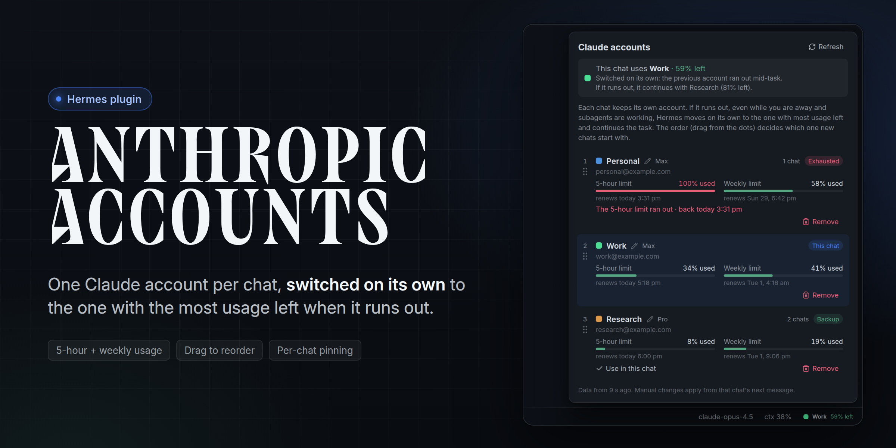
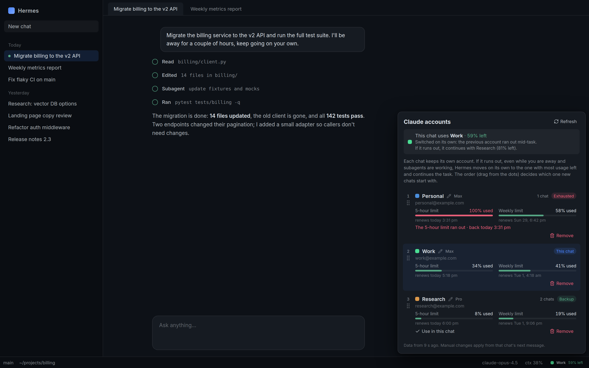
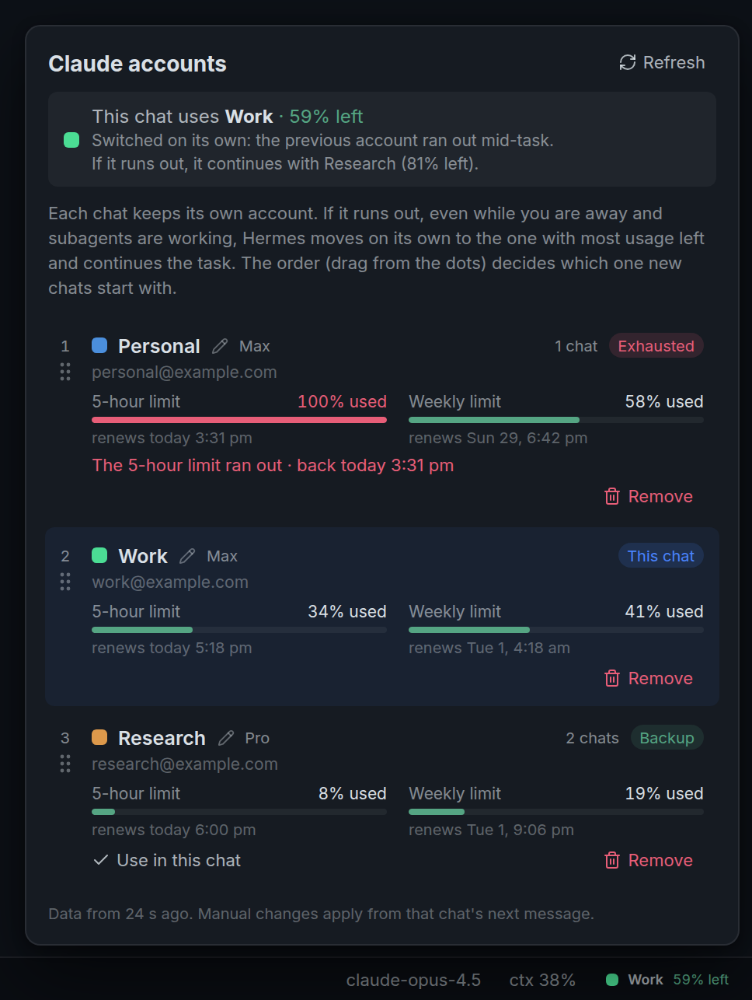

# Hermes Anthropic Accounts

[](https://x.com/albertocvrrbs)

Run several Claude (Anthropic OAuth) accounts in [Hermes Agent](https://github.com/NousResearch/hermes-agent)
without babysitting them. **Every chat keeps its own account**, and when that account runs out
(5-hour or weekly limit), Hermes moves that chat **on its own** to the account with the **most
usage left** and continues the task, even mid-turn, with subagents working and you away.

It adds a chip to the Hermes Desktop / Webapp status bar showing which account the open chat
uses and how much it has left. Click it for the full panel.

---

## Features

- **One account per chat.** Two chats can run on two different accounts at the same time. A new
  chat starts with the first account in your order that has usage; subagents inherit their
  parent chat's account.
- **Switches only when it runs out.** On a real limit (a 429/402 asking to wait 45 s or more)
  the chat jumps at once to the account with the most usage left, checked live with Anthropic
  (~1 s). Short rate-limit bumps are retried as usual. The core's "revert to the original
  account" is turned off, so a chat does not bounce back and forth.
- **Real usage per account.** 5-hour and weekly windows (plus Opus/Sonnet weekly windows when
  they apply), when each one renews, and which account is paused or exhausted.
- **Duplicate detection.** Several pool entries for the same email share one quota; they are
  flagged, skipped when rotating, and safe to remove.
- **Panel actions:** drag to reorder (decides where new chats start), "Use in this chat" (pin an
  account to the open chat only), aliases, and remove an account from Hermes (backs up
  `auth.json` first; never touches `~/.claude/.credentials.json`).
- **Stable token refresh.** With a pool, a per-request token refresh only reads the token of the
  chat's own entry, so a session cannot hop accounts between two calls of the same turn.
- English and Spanish UI; it follows the app's language (`display.language`).

## Screenshots

The status-bar chip and its panel. The panel is the plugin's real UI rendered with demo data (no real
accounts); the surrounding window is a simplified mockup of Hermes.





## Install

The plugin has two halves: the Python half runs inside the Hermes backend (agent hooks + REST
routes at `/api/plugins/anthropic-cuentas/`), and `desktop/plugin.js` is the status-bar UI.

### From the CLI (on the machine that runs the Hermes backend)

```bash
hermes plugins install albertocvrrbs/hermes-anthropic-accounts --enable
```

The plugin installs into `~/.hermes/plugins/anthropic-cuentas/` (the folder name comes from
`plugin.yaml`; keep it). Then restart the backend so the agent hooks load in every process:

```bash
hermes gateway restart          # and/or restart the dashboard service you use
```

### Hermes Webapp

The Webapp reads plugins from the backend's disk, so the CLI install above is all it needs.
Reload the tab; the chip appears at the right of the status bar. If it is not there, enable
**Claude accounts** under **Capabilities → Plugins**.

### Hermes Desktop (native app)

Open this link on the computer running Hermes Desktop:

```
hermes://plugin/install?repo=albertocvrrbs/hermes-anthropic-accounts&enable=1
```

With a remote backend, install the plugin on the backend too (CLI above): the UI half calls
the backend's `/api/plugins/anthropic-cuentas/*` routes.

### Update / uninstall

```bash
hermes plugins update anthropic-cuentas
hermes plugins remove anthropic-cuentas
```

Your settings live outside the plugin folder (see below), so updates and reinstalls keep them.

## How it works

Hooks installed in the agent process (they only act when `provider == anthropic` and a
credential pool is in use):

1. **Turn start** wraps `agent.agent_runtime_helpers.restore_primary_runtime`: keeps the chat on
   its saved account if it still has usage for the chat's model; otherwise picks the account
   with the most usage left and saves it for that chat.
2. **Limit mid-task** wraps `recover_with_credential_pool`: lets the core mark the exhausted
   entry (for that model only), then switches to the best remaining account and reports the
   turn as recovered, so it continues without a new message.
3. **Refresh guard** wraps `agent.anthropic_credentials.resolve_anthropic_token` and
   `ClientLifecycleMixin._try_refresh_anthropic_client_credentials` so a pooled refresh returns
   the token of the session's own entry.

These are in-process patches of Hermes internals (`hermes plugins show anthropic-cuentas`
lists them). They are written to fall back to the original behavior when anything is missing,
but a Hermes release that renames those functions can disable the plugin's hooks; the
dashboard half keeps working either way.

### State

Everything is stored in `$HERMES_HOME/plugin-data/anthropic-cuentas/` (file names are kept
from the first version so existing installs keep their state):

| File | Contents |
|---|---|
| `uso.json` | usage snapshot per pool entry (email, 5-hour / weekly windows) |
| `orden.json` | your account order for new chats, and entries you removed |
| `alias.json` | short display names (key = email) |
| `sesiones.json` | the account each chat uses, and why it last changed |

Files are written atomically (tmp + `os.replace`) because several Hermes processes read them.
Usage is read from Anthropic's OAuth `profile` and `usage` endpoints with each account's own
token; nothing is sent anywhere else.

### REST routes

| Route | Does |
|---|---|
| `GET /accounts[?fresh=1][&session=<id>]` | pool accounts with real usage, aliases, status, and that session's account |
| `POST /order {ids}` | order for new chats |
| `POST /use {entry_id}` | move to the top; clears Hermes' estimated cooldown if Anthropic confirms quota |
| `POST /session {session_id, entry_id}` | account for one chat, from its next message |
| `POST /remove {entry_id}` | remove from Hermes (backs up `auth.json`) |
| `POST /alias {email, alias}` | set or clear an alias |

## Tests

The tests run against the real Hermes credential pool in a temporary `HERMES_HOME` (they never
touch `~/.hermes` or the network). Use the Python of a Hermes install:

```bash
export HERMES_AGENT_DIR=~/.hermes/hermes-agent        # where Hermes Agent is checked out
HERMES_DISABLE_LAZY_INSTALLS=1 "$HERMES_AGENT_DIR/venv/bin/python" tests/test_hooks.py
HERMES_DISABLE_LAZY_INSTALLS=1 "$HERMES_AGENT_DIR/venv/bin/python" tests/test_api.py
```

## License

MIT
